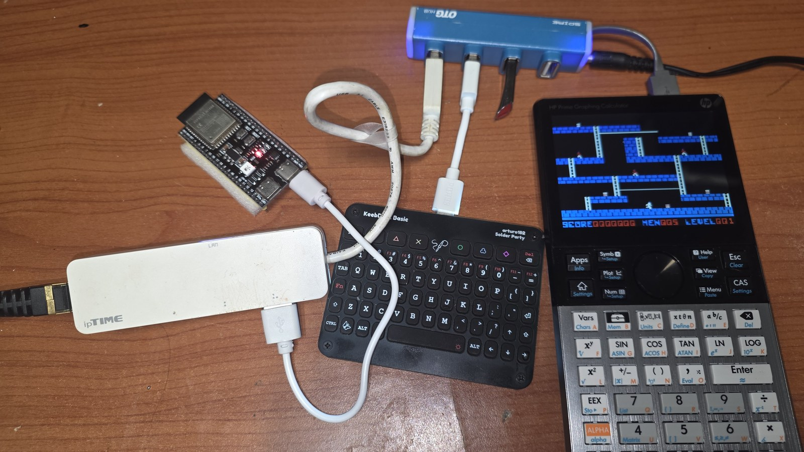
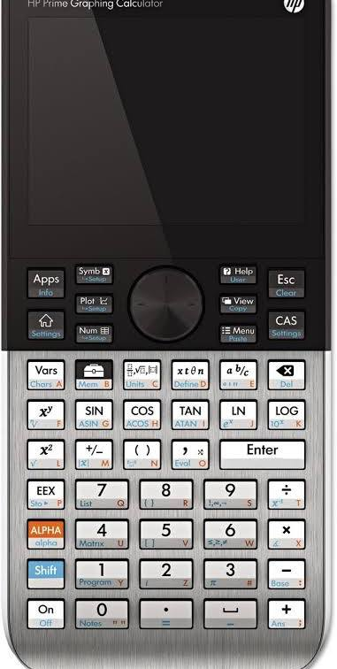
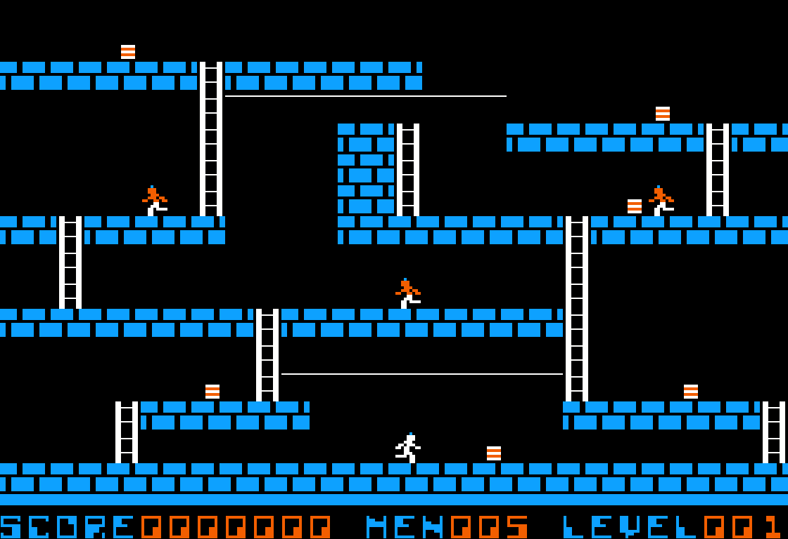
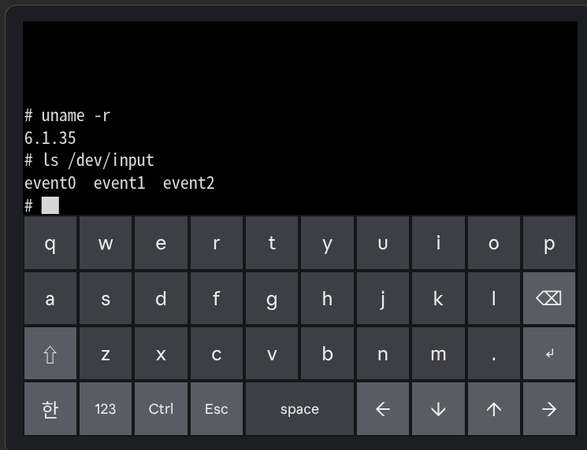
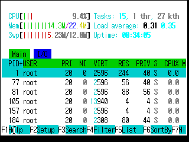
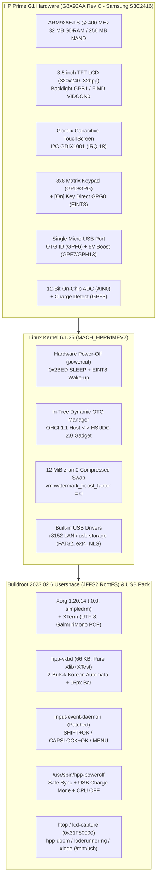
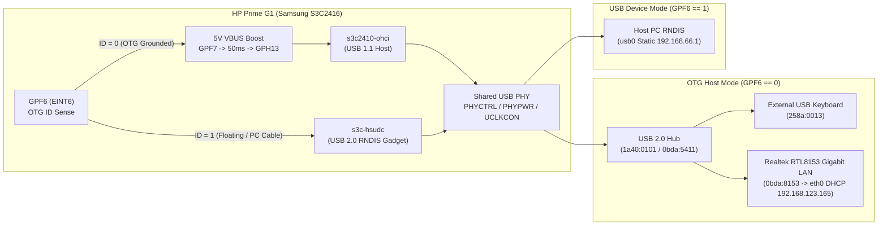
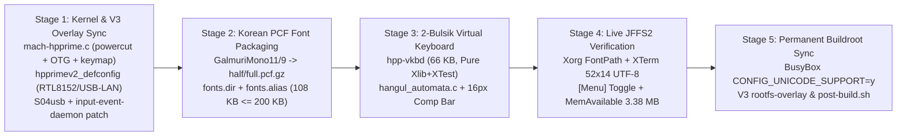
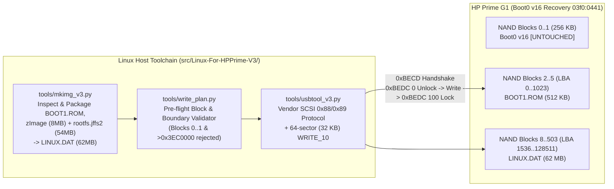
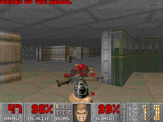

# HP Prime G1 (`G8X92AA`) Embedded Linux 6.1.35 Complete Platform

A complete, hardware-verified Embedded Linux platform for the **HP Prime G1 Graphing Calculator (`G8X92AA` Hardware Revision C, Samsung S3C2416 ARM926EJ-S @ 400 MHz, 32 MB SDRAM, 256 MB NAND)**.

This repository consolidates every engineering milestone from initial V3 Linux installation and bootloader debugging to dual-role USB OTG (Hub + Keyboard + Gigabit Ethernet LAN + USB Memory / Mass Storage for unlimited external flash storage & portable app execution), 32 MB RAM / `zram` OOM & livelock optimization, retro game porting (Doom & Lode Runner), hardware power-off/wake-up & USB charging mode control, and Korean PCF bitmap fonts with an ultra-lightweight 2-Bulsik touchscreen virtual keyboard.

> ### Key Platform Highlights
> - **Unlimited Storage & External Hardware Expansion via USB OTG**: By leveraging **USB OTG Host Mode (5V VBUS Boost + OHCI 1.1 + Multi-Port USB Hub)**, the HP Prime G1 overcomes its internal **256 MB NAND flash limitation** by mounting external **USB Flash Drives (USB Memory)** for virtually unlimited storage, and transforms into an extensible hardware control hub capable of driving **ESP32 boards and external USB peripherals (Microphone, Speaker/Audio DAC, Temperature & Environmental Sensors, Serial/GPIO actuators, etc.)** alongside an external keyboard and Ethernet LAN.
> - **Dedicated Calculator Keypad Power-On/Off, Soft-Reset (Reboot) & Automatic Battery Charging Mode**: Dedicated physical button bindings enable one-step **Hardware Power-Off (`[Shift] + [On]`)**, pin-free front-panel **Power-On Wake-Up (`[On]` via `GPG0`/`EINT8`)**, and **Soft-Reset / Reboot (`[Alpha] + [On]`)**. Upon Power-Off, the system turns off the LCD backlight (`GPB1`)/display (`VIDCON0`), enters **S3C2416 Hardware SLEEP Mode (`0x2BED`, CPU OFF)**, and **automatically switches the Micro-USB port into internal Li-Ion Battery Charging Mode** (disabling 5V OTG reverse boost `GPF7`/`GPH13`, cutting D+ pull-up `GPH14`, and suspending the USB PHY).

| Live USB OTG Expansion Setup: HP Prime G1 (Lode Runner NG) + Powered 4-Port USB OTG Hub + USB Flash Drive + Mini Keyboard + USB Ethernet LAN + ESP32-S3 |
| :---: |
|  |

| HP Prime G1 Hardware & Keypad (`G8X92AA`) | Lode Runner (`320x240` Port on HP Prime G1) | Korean PCF Font & 2-Bulsik Virtual Keyboard (`hpp-vkbd`) |
| :---: | :---: | :---: |
|  |  |  |

| Lode Runner NG (`320x240` Direct LCD Capture) | `htop` Live Monitor (`320x240` Direct LCD Capture) | DOOM (`PrBoom`, `320x240` Direct LCD Capture) |
| :---: | :---: | :---: |
|  |  |  |

---

## 1. System Architecture Overview



---

## 2. Key Engineering Milestones

| # | Milestone | Summary of Achievements | Documentation |
| :---: | :--- | :--- | :--- |
| **00** | **System Specifications** | S3C2416 SoC, 32 MB SDRAM (`23.4 MB` kernel-managed), 256 MB NAND MTD map, interrupt & I/O register layout | [docs/00_System-Information.md](docs/00_System-Information.md) |
| **01** | **Linux V3 Installation & Boot** | Boot0 (`mtd0`/`mtd1`) write-protection, BOOT1 & `LINUX.DAT` flashing, bare `earlycon` NULL FDT kernel fix (`drivers/of/fdt.c`) | [docs/01_Linux-Installation-and-Boot.md](docs/01_Linux-Installation-and-Boot.md) |
| **02** | **USB RNDIS & SSH/SCP Network** | USB Gadget RNDIS (`192.168.66.1`), Dropbear SSH passwordless ED25519 authentication, legacy `scp -O` file transfer | [docs/02_RNDIS-and-SSH-Network.md](docs/02_RNDIS-and-SSH-Network.md) |
| **03** | **Dual-Role USB OTG & Ethernet LAN** | Dynamic `GPF6` ID hot-plug (5V VBUS boost `GPF7`/`GPH13` + USB Hub + External Keyboard + Realtek RTL8153 LAN `192.168.123.165` Auto-DHCP) and `<smdk2416_hsudc_gpio_init>` cold-boot hang fix (`S04usb`) | [docs/03_USB-OTG-Hotplug-and-Ethernet-LAN.md](docs/03_USB-OTG-Hotplug-and-Ethernet-LAN.md) |
| **04** | **Memory (OOM/zram), X11 & Battery** | Eliminated 81-minute NAND swap livelock & 4 MB pageblock boost OOM via `12 MiB /dev/zram0` and `vm.watermark_boost_factor=0`; fixed `320x240` XTerm clipping; added `hpp-batt` ADC battery monitor | [docs/04_Memory-OOM-Zram-and-X11-Optimization.md](docs/04_Memory-OOM-Zram-and-X11-Optimization.md) |
| **05** | **Retro Games & Applications** | Ported Doom (`PrBoom 2.5.0`, `hpp-doom`) and Lode Runner (`loderunner-ng` 16bpp direct renderer, `xlode`) to `320x240` LCD with physical keypad mapping | [docs/05_Retro-Games-and-Apps-Porting.md](docs/05_Retro-Games-and-Apps-Porting.md) |
| **06** | **Keypad `Ctrl+C` & Hardware Power Control** | Mapped `[Help]` to `Control_L` (`[Help]+[C]` = `Ctrl+C`); patched 4 bugs in `input-event-daemon`; implemented `[Shift]+[On]` true hardware power-off (`GPB1` backlight OFF, USB charging mode, `0x2BED` S3C2416 SLEEP) and `[On]` key (`GPG0`/`EINT8`) cold-boot wake-up | [docs/06_Keypad-CtrlC-and-Hardware-Power-Control.md](docs/06_Keypad-CtrlC-and-Hardware-Power-Control.md) |
| **07** | **Korean PCF Font & 2-Bulsik Virtual Keyboard** | Generated 1:2 charcell `GalmuriMono11`/`9` PCF bitmap font subsets (`108 KB`); built `hpp-vkbd` (`66 KB`, pure `libX11`+`libXtst`) with 2-Bulsik Hangul automata, 16px pre-commit composition bar, dynamic XTerm resizing, and `[Menu]` key toggle | [docs/07_Korean-PCF-Font-and-2Bulsik-Virtual-Keyboard.md](docs/07_Korean-PCF-Font-and-2Bulsik-Virtual-Keyboard.md) |
| **08** | **USB Mass Storage, Power Stability & USB Pack** | Kernel `#7` built-in `SCSI`/`usb-storage`/`FAT32`/`ext4`/`NLS_UTF8` & `CP949`; `zram0` + `boost=0` bulk-transfer stabilization; `/root/.profile` (`um`/`uu` aliases); `8.9 MB` portable `/mnt/usb/HP-Prime-G1-USB` game & tool pack | [docs/08_USB-Mass-Storage-and-USB-App-Pack.md](docs/08_USB-Mass-Storage-and-USB-App-Pack.md) |
| **09** | **`htop` & Direct-Scanout `lcd-capture`** | Non-wide `ncurses` ARMv5TEJ `htop 3.6.0-dev` (`263 KB`) & physical `simple-framebuffer` (`0x31F80000`) PNG/BMP/PPM `lcd-capture` (`66 KB`) with zero-flash SSH streaming & live `320x240` captures | [docs/09_Htop-and-LCD-Capture.md](docs/09_Htop-and-LCD-Capture.md) |

---

## 3. Physical Keypad & Touchscreen Shortcut Reference

| Key Combination | Kernel Matrix / GPIO | Assigned Action | Handler |
| :--- | :--- | :--- | :--- |
| **`[Shift] + [On]`** | `KEY(3,6, KEY_LEFTSHIFT)` + `KEY(0,0, KEY_OK)` | **Hardware Power-Off** (Backlight OFF + USB Charging Mode + S3C2416 `0x2BED` CPU SLEEP) | `/usr/sbin/hpp-poweroff` |
| **`[On]` (While Off)** | `GPG0` (`EINT8` Active-High Direct) | **Hardware Power-On** (Boot0 Cold Boot into Linux) | S3C2416 `EINT8` Wake-up |
| **`[Alpha] + [On]`** | `KEY(2,3, KEY_CAPSLOCK)` + `KEY(0,0, KEY_OK)` | **Safe System Reboot** (`sync; /sbin/reboot`) | `input-event-daemon` |
| **`[Menu]`** | `KEY(5,2, KEY_MENU)` | **Toggle Touchscreen Virtual Keyboard** (`hpp-vkbd` show/hide & XTerm auto-resize `320x96` <-> `320x240`) | `/usr/bin/hpp-vkbd-toggle` |
| **`[Help] + [C]`** | `KEY(5,7, KEY_LEFTCTRL)` + `KEY(2,2, KEY_C)` | **Terminal Interrupt (`Ctrl+C` / `SIGINT`)** | XKB `<HELP>` = `Control_L` |
| **`[Symb]`** | `KEY(4,2, KEY_TAB)` | **Shell `Tab` Auto-Completion** | Kernel `matrix-keypad` |

---

## 4. Dual-Role USB OTG Hot-Plug, 5V VBUS Boost & USB-to-Ethernet (LAN)

The single Micro-USB port on the HP Prime G1 dynamically switches between **USB Host Mode (5V VBUS Boost + OHCI 1.1)** and **USB Device Mode (HSUDC 2.0 RNDIS Gadget)** without rebooting, driven by an in-tree kernel interrupt manager (`hpprime_otg_init` in [kernel/arch/arm/mach-s3c/mach-hpprime.c](kernel/arch/arm/mach-s3c/mach-hpprime.c)) and the cold-boot-safe [rootfs-overlay/etc/init.d/S04usb](rootfs-overlay/etc/init.d/S04usb) helper.

### 4.1 Hardware Topology & Dynamic Mode Switching Flow



### 4.2 S3C2416 USB OTG Hardware Control Matrix

| Register / GPIO | Physical Address | Host Mode (`GPF6 == 0`) | Device Mode (`GPF6 == 1`) | Power-Off Charging Mode |
| :--- | :---: | :--- | :--- | :--- |
| **`GPF6` (`EINT6`)** | `0x56000054` Bit 6 | `0` (OTG Adapter Inserted) | `1` (OTG Removed / PC Cable) | Don't Care (`EINT8` Wake-up only) |
| **`GPF7` (`VBUS_EN1`)** | `0x56000054` Bit 7 | **`1` (5V Step-Up Converter ON)** | `0` (5V Boost OFF) | **`0` (5V Boost OFF)** |
| **`GPH13` (`VBUS_EN2`)**| `0x56000074` Bit 13 | **`1` (VBUS 5V Output Rail ON)** | `0` (VBUS Output OFF) | **`0` (VBUS Output OFF)** |
| **`GPH14` (`USB_PWR`)** | `0x56000074` Bit 14 | `1` (USB Aux Power ON) | `1` (D+ Pull-Up ON) | **`0` (D+ Pull-Up OFF)** |
| **`EPLLCON`** | `0x4C000028` | `0x00200102` (96 MHz -> `/2` = 48 MHz) | — | Disabled in `0x2BED` SLEEP |
| **`PHYCTRL` / `PHYPWR`**| `0x4C000080` / `84` | `0x00000000` / `0x00000000` | `0x00000012` / `0x00000030` | `PHYPWR |= 0x0F` (Force Suspend) |
| **`UCLKCON`** | `0x4C00008C` | `0x00000002` (Host Clock) | `0x00000007` (VBUS + UDC Clock) | `0x00000000` (All USB Clocks OFF) |
| **Active Network** | — | **`eth0` (`192.168.123.165` via `udhcpc`)** | **`usb0` (`192.168.66.1` via `dnsmasq`)** | Pure Battery Charger IC Only |

### 4.3 Cold-Boot OTG Safety (`<smdk2416_hsudc_gpio_init>` Hang Prevention)
Because the S3C2416 shares a single USB PHY between `s3c2410-ohci` (Host) and `s3c-hsudc` (Device), binding `s3c-hsudc` while 5V OTG Host mode (`GPF6 == 0`) is active resets the Host PHY and clears `UCLKCON_FUNC_CLKEN`, freezing boot at `<smdk2416_hsudc_gpio_init>`.
- **[rootfs-overlay/etc/init.d/S04usb](rootfs-overlay/etc/init.d/S04usb)** reads physical `GPFDAT (0x56000054)` Bit 6 at boot and during hot-plug events: it strictly skips ConfigFS UDC binding whenever `GPF6 == 0`, allowing cold-boot with an OTG hub, external USB keyboard, and RTL8153 Ethernet adapter connected simultaneously.
- Full technical details: [docs/03_USB-OTG-Hotplug-and-Ethernet-LAN.md](docs/03_USB-OTG-Hotplug-and-Ethernet-LAN.md).

---

## 5. Korean PCF Bitmap Font & 2-Bulsik Touchscreen Virtual Keyboard (`80_kr-input`)

To enable Korean UTF-8 display and input on the `320x240` LCD without the heavy RAM overhead of `libXft`/`freetype`/`fontconfig`, we built a complete X11 Core Bitmap Font (`PCF.gz`) and pure `libX11`+`libXtst` virtual keyboard suite in [src/80_kr-input/](src/80_kr-input).


### 5.1 1:2 Charcell Korean PCF Bitmap Fonts (`src/80_kr-input/fonts/`)
- **Generator**: [src/80_kr-input/fonts/bdf_subset.py](src/80_kr-input/fonts/bdf_subset.py) filters `GalmuriMono11.bdf` and `GalmuriMono9.bdf` by exact glyph `DWIDTH` and normalizes XLFD properties (`SPACING="C"`, `CHARSET_REGISTRY="iso10646-1"`).
- **Subsets & Footprint (`108 KB` total in `/usr/share/fonts/X11/hangul/`)**:

| Font Alias | File | Cell Size (`DWIDTH x PIXEL_SIZE`) | Glyph Count | Included Unicode Blocks | Size |
| :--- | :--- | :---: | :---: | :--- | :---: |
| **`kr-half`** | `half.pcf.gz` | **`6 x 16 px`** (Half-Width) | 191 glyphs | ASCII (`0020-007E`), Latin-1 (`00A0-00FF`) | `3.4 KB` |
| **`kr-full`** | `full.pcf.gz` | **`12 x 16 px`** (Full-Width) | 2,717 glyphs | **KS X 1001 2,350 Hangul syllables**, Compatibility Jamo (`3131-318E`), Arrows (`2190-21FF`), Box Drawing (`2500-257F`) | `46.0 KB` |
| **`kr9-half`** | `m9_half.pcf.gz` | **`5 x 12 px`** (Half-Width) | 185 glyphs | ASCII, Latin-1 (High-density 64-column option) | `3.2 KB` |
| **`kr9-full`** | `m9_full.pcf.gz` | **`10 x 12 px`** (Full-Width) | 2,706 glyphs | KS X 1001 2,350 Hangul, Compatibility Jamo, Arrows, Box Drawing | `43.0 KB` |

- **Xorg & XTerm Integration**:
  - Registered via [rootfs-overlay/etc/X11/xorg.conf.d/10-hangul-fonts.conf](rootfs-overlay/etc/X11/xorg.conf.d/10-hangul-fonts.conf) (`FontPath "/usr/share/fonts/X11/hangul/"` alongside `misc/` and `built-ins`).
  - Launched in [rootfs-overlay/etc/init.d/S99xterm](rootfs-overlay/etc/init.d/S99xterm) as:
    ```sh
    xterm -u8 -wc -cjk_width -fn kr-half -fw kr-full -ls -geometry 52x14+0+0 &
    ```

### 5.2 Ultra-Lightweight 2-Bulsik Virtual Keyboard (`src/80_kr-input/vkbd/hpp-vkbd`)
- **Pure `libX11` + `libXtst` (`66 KB` binary, `RssAnon 744 kB`, system `MemAvailable 3,380 kB`)**:
  - Reuses the `kr-half` / `kr-full` X11 core fonts directly via `XLoadQueryFont` (0 KB extra font RAM).
  - Injects UTF-8 characters into `xterm` by mapping `0x01000000 | Unicode` keysyms onto two ping-pong unused keycodes (`248`, `230`) via `XChangeKeyboardMapping` + `XTestFakeKeyEvent` (verified by [src/80_kr-input/probes/xtest_utf8_probe.c](src/80_kr-input/probes/xtest_utf8_probe.c)).
- **WM-Less Window Management & Dynamic XTerm Resizing (`320x240` <-> `320x96`)**:
  - Runs with `override_redirect = True` so touchscreen taps on the virtual keyboard never steal input focus from `xterm`.
  - Automatically resizes `xterm` to the top **`320x96`** (`y: 0..95`) when launched and restores `xterm` to full-screen **`320x240`** on exit ([src/80_kr-input/probes/wm_resize_probe.c](src/80_kr-input/probes/wm_resize_probe.c)).
- **2-Bulsik Hangul Automata & `16px` Pre-Commit Composition Bar (`y: 96..111`)**:
  - [src/80_kr-input/vkbd/hangul_automata.c](src/80_kr-input/vkbd/hangul_automata.c) implements 19 initial consonants, 21 medial vowels (7 compound vowels `ㅘ ㅙ ㅚ ㅝ ㅞ ㅟ ㅢ`), 27 final consonants (11 compound finals `ㄳ ㄵ ㄶ ㄺ ㄻ ㄼ ㄽ ㄾ ㄿ ㅀ ㅄ`), Dokkaebibul liaison splitting, and step-by-step Jamo backspace decomposition inside the `16px` composition preview bar (`Comp:[한]`).
- **Physical `[Menu]` Key Toggle**:
  - Bound to `MENU = /usr/bin/hpp-vkbd-toggle` in [rootfs-overlay/etc/input-event-daemon.conf](rootfs-overlay/etc/input-event-daemon.conf).
- Full technical details: [docs/07_Korean-PCF-Font-and-2Bulsik-Virtual-Keyboard.md](docs/07_Korean-PCF-Font-and-2Bulsik-Virtual-Keyboard.md).

---

## 6. Unified Platform Integration Summary (`Power-On/Off + USB-OTG + Korean Input`)

This section summarizes the 5-stage permanent integration strategy unifying **Hardware Power Control (`100`)**, **Dual-Role USB OTG & Ethernet LAN (`50`)**, **Keypad `Help=Ctrl` & Daemon Fixes (`61`)**, and **Korean PCF Font & 2-Bulsik Virtual Keyboard (`92`)** across the kernel, Buildroot/BusyBox, V3 RootFS overlay, and live JFFS2 filesystem.



### 6.1 Unified Hardware & Software Verification Matrix

| Subsystem | Kernel / Userspace Component | Target JFFS2 Path | Verified Metric & Behavior |
| :--- | :--- | :--- | :--- |
| **1. Hardware Power-Off & Wake-Up** | [hpp_poweroff.c](src/hpp-poweroff/hpp_poweroff.c)<br>[mach-hpprime.c](kernel/arch/arm/mach-s3c/mach-hpprime.c) `powercut()` | `/usr/sbin/hpp-poweroff` (`66 KB`) | **`[Shift]+[On]`**: `GPB1`/`VIDCON0` instant OFF -> `sync` & RO remount -> USB charging mode (`GPF7`/`GPH13`/`GPH14` OFF, PHY suspend) -> `GPG0` 100ms release debounce -> `EINT8` Rising-Edge wake-up -> `INFORM0..3=0` -> **`PWRMODE=0x2BED` (CPU OFF)**. **`[On]`**: instant Cold Boot |
| **2. Dual-Role USB OTG & LAN** | [mach-hpprime.c](kernel/arch/arm/mach-s3c/mach-hpprime.c) `hpprime_otg_init()`<br>[hpprimev2_defconfig](kernel/arch/arm/configs/hpprimev2_defconfig) | `/etc/init.d/S04usb`<br>`/etc/udev/rules.d/99-eth.rules` | **`GPF6` (`EINT6`)** real-time Host (`5V` VBUS boost + OHCI + Hub/Keyboard/RTL8153 LAN `192.168.123.165`) <-> Device (`s3c-hsudc` RNDIS `192.168.66.1`) switching; cold-boot safe (`S04usb` skips UDC bind when `GPF6==0`) |
| **3. Keypad Daemon & `Ctrl+C`** | [input-event-daemon.c](src/input-event-daemon/input-event-daemon.c)<br>[hpp-keymap.xkb](rootfs-overlay/etc/X11/hpp-keymap.xkb) | `/usr/bin/input-event-daemon` (`66 KB`)<br>`/etc/input-event-daemon.conf` | Patched 4 daemon bugs (`SHIFT` duplicate check, `value==2` autorepeat filter, press-trigger, `qsort` pointer comparator); mapped `[Help]` (`KEY_LEFTCTRL`) to `Control_L` (`[Help]+[C]` = `Ctrl+C`) |
| **4. Korean PCF Bitmap Fonts** | [bdf_subset.py](src/80_kr-input/fonts/bdf_subset.py)<br>[10-hangul-fonts.conf](rootfs-overlay/etc/X11/xorg.conf.d/10-hangul-fonts.conf) | `/usr/share/fonts/X11/hangul/*`<br>(`108 KB` total, budget `<= 200 KB`) | 1:2 charcell `GalmuriMono11` (`kr-half` `6x16` / `kr-full` `12x16`) & `GalmuriMono9` (`5x12` / `10x12`), KS X 1001 2,350 Hangul + Compatibility Jamo + Arrows |
| **5. 2-Bulsik Virtual Keyboard** | [hpp_vkbd.c](src/80_kr-input/vkbd/hpp_vkbd.c)<br>[hangul_automata.c](src/80_kr-input/vkbd/hangul_automata.c) | `/usr/bin/hpp-vkbd` (`66 KB`)<br>`/usr/bin/hpp-vkbd-toggle`<br>`/etc/init.d/S99xterm` | **`[Menu]`** key toggle; 6 layers (EN/KR 2-Bulsik/Double Jamo/Symbols); `16px` pre-commit composition bar (`Comp:[한]`); auto-resizes XTerm (`320x96` <-> `320x240`); **`MemAvailable = 3,380 kB`** (`>= 3.0 MB` budget) |

---

## 7. Host Recovery-Mode Analysis & Safety Guard Tool (`20_HPPrime-Tool`)

[src/20_HPPrime-Tool/](src/20_HPPrime-Tool) unifies read-only recovery inspection, synthetic sector verification, and Boot0 v16 layout modeling into a single host CLI tool (`cli.py`) backed by **95 offline unit tests** (`tests/`). It enforces hard code-level write blocks to protect physical NAND Blocks `0~1` (Boot0) prior to Linux `nanddump` verification.

### 7.1 Key Reverse-Engineering Findings Embedded in `20_HPPrime-Tool`
1. **Standard Boot0 v16 Recovery USB Disk (`READ_10`) is Synthetic, Not Raw NAND**:
   - Disassembly of `BXCBOOT0V16.bin` proved that standard Recovery Mode (`mode 2`) `READ_10` does **not** read NAND flash; it zeroes the buffer and synthesizes only four MBR/FAT sectors (`LBA 0`, `0x20000`, `0x20008`, `0x20018`).
   - `cli.py synth-check` verifies whether a 256 MB recovery dump matches this synthetic Boot0 response.
2. **Invalidated Legacy `Physical = Logical + 0x40000` Assumption**:
   - `0x40000` (`256 KB`) in Boot0 is the RAM transfer buffer size, while actual `WRITE_10` LBA-to-NAND translation uses the block remapping table at Page 4 (`BFX` header, `table[LBA >> 8]` starting at physical Block 2 when no bad blocks exist).
3. **Code-Enforced Hardware Safety Locks**:

| Guard ID | Enforced Safety Rule | Module Location | Unit Test Suite |
| :---: | :--- | :--- | :--- |
| **`a`** | **`boot0 --execute` and `LinuxTransport` write instantiation are permanently blocked** (`PermissionError`), preventing any host-side Boot0 overwrite | `cli.run_boot0`, `hpprime/vendor.py` | `test_safety.py` (`Boot0BlockTests`) |
| **`b`** | **Vendor command `0xBEC2` (Boot0 Block 0 erase/rewrite at `0x7988`) is rejected before packet construction** | `hpprime/vendor.py` | `test_safety.py` |
| **`c`** | **LBA 170 and 30/31-sector control reads are blocked before `SG_IO` `ioctl`** (prevents Boot0 lock-flag mismatch CSW status 7 USB reset) | `hpprime/dump.py` (`check_read_request`) | `test_safety.py` (`ControlRequestTests`) |
| **`d`** | **Read-only kernel block guard (`sysfs ro == 1`) & `O_RDONLY | O_EXCL`** required before opening any recovery disk device | `hpprime/device.py`, `hpprime/dump.py` | `test_safety.py` (`PreflightTests`) |
| **`e`** | **Layout Planner (`cli.py plan --ini`)** models `LBA`, logical/physical NAND blocks, and MTD partition overlaps, rejecting any image touching Blocks `0~1` or exceeding `0x3EC0000` | `hpprime/layout.py`, `hpprime/vendor.py` | `test_layout.py`, `test_vendor.py` |

### 7.2 CLI Subcommands & Offline Verification
```bash
# Inspect connected HP Prime USB recovery device (read-only sysfs check, does not open device)
python3 -B src/20_HPPrime-Tool/cli.py status

# Verify whether a 256 MB recovery image is a Boot0 v16 synthetic response
python3 -B src/20_HPPrime-Tool/cli.py synth-check BXCBOOT0V16.bin recovery-disk.bin

# Model LBA-to-NAND block mapping and MTD partition overlap from a usbtool.ini file
python3 -B src/20_HPPrime-Tool/cli.py plan --ini usbtool.ini

# Run all 95 offline safety and layout unit tests (no hardware required)
cd src/20_HPPrime-Tool && python3 -B -m unittest discover -s tests -v
```

---

## 8. V3 Second-Stage Bootloader & Native Linux Flashing Toolchain (`Linux-For-HPPrime-V3`)

[src/Linux-For-HPPrime-V3/](src/Linux-For-HPPrime-V3) provides the V3 second-stage bootloader (`BOOT1.ROM`), image packager (`mkimg_v3.py`), and Linux-native SCSI `SG_IO` flashing engine (`usbtool_v3.py`), eliminating any dependency on Windows `usbtool.exe` while protecting Boot0 (`Physical Blocks 0~1`).



### 8.1 Key Improvements Over Legacy V2 (`BOOT1` & `usbtool_v3.py`)

| Component | Legacy V2 Issue / Limitation | V3 Solution Implemented in `Linux-For-HPPrime-V3` |
| :--- | :--- | :--- |
| **`bootloader/boot.c` (`BOOT1.ROM`)** | ① `powu32(2, sdiv)` infinite loop bug; ② `set_flash_lock_boundary(10, 2040)` locked the first 2 blocks (`8~9`) of the kernel partition; ③ bare `earlycon` cmdline hung Linux 6.1.35 on NULL FDT (`ATAG` boot); ④ uncleaned D-cache/MMU entry | ① Replaced with `(1U << sdiv)` bit shift; ② fixed lock boundary to `(8, 2040)` using row/page addresses (`block * 64`); ③ removed bare `earlycon` and set `root=mtd:rootfs`; ④ preserved Boot0 `NFCONF`/`NFCONT` timings, added zImage magic (`0x016F2818`) check, CP15 D-cache clean/invalidate & MMU disable before kernel jump |
| **`tools/mkimg_v3.py`** | Shell `dd` script without header or partition overflow validation | Validates 32-byte Boot0-compatible `BOOT1` header (`+0x00: 0x30000020`, `+0x14: "V5J\0"`, `+0x18: "2416"`, tail `0xAA`), `zImage` magic (`<= 8 MiB`), and `rootfs.jffs2` magic (`0x1985`, `<= 54 MiB`) before building `LINUX.DAT` |
| **`tools/usbtool_v3.py` (Control Path)** | LBA 170 30-sector `READ_10` unlock modified `[0x30d6f412]` mid-read, causing Boot0 v16 to return CSW status 7 and triggering a Linux `usb-storage` bus reset | Switched exclusively to 264-byte vendor SCSI commands **`0x88` (send) / `0x89` (receive)**: `0xBECD/0xBEAD` handshake -> `0xBEDC 0` unlock -> progress `0xBEDC 1..99` -> `0xBEDC 100` lock (`0` `READ_10` commands issued) |
| **`tools/usbtool_v3.py` (Write Chunks)** | 256-sector (`128 KiB`) `WRITE_10` failed with `EIO` on Linux (`max_hw_sectors_kb = 120`) | Split `128 KiB` NAND eraseblocks into four **64-sector (`32 KiB`)** `WRITE_10` chunks strictly aligned within block boundaries |
| **`kernel/patches/`** | Early boot hang on ATAG boot (`initial_boot_params == NULL`) and writable Boot0 MTD partition | `0001`: `drivers/of/fdt.c` NULL FDT check + `mtdcore.c` master `mtd0` read-only + `mach-hpprime.c` `mtd1 "HP Boot Code"` read-only (`MTD_WRITEABLE` masked) |

### 8.2 Key Commands (`mkimg_v3.py` & `usbtool_v3.py`)
```bash
# 1. Inspect BOOT1.ROM, zImage, and rootfs.jffs2 headers and sizes
python3 src/Linux-For-HPPrime-V3/tools/mkimg_v3.py inspect BOOT1.ROM zImage rootfs.jffs2

# 2. Build combined 62 MiB LINUX.DAT image
python3 src/Linux-For-HPPrime-V3/tools/mkimg_v3.py build --zimage zImage --rootfs rootfs.jffs2 --output LINUX.DAT

# 3. Dry-run flash plan validation (default safe simulation mode, no device opened)
python3 src/Linux-For-HPPrime-V3/tools/usbtool_v3.py flash --ini src/Linux-For-HPPrime-V3/usbtool.ini

# 4. Non-destructive hardware handshake probe (1x 0x88/0x89 0xBECD exchange, zero NAND writes)
python3 src/Linux-For-HPPrime-V3/tools/usbtool_v3.py probe --device /dev/sdX --execute --confirm-g1 --confirm-recovery-v16

# 5. Run all 57 offline V3 bootloader, image builder, and writer unit tests
cd src/Linux-For-HPPrime-V3 && python3 -B -m unittest discover -s tests -v
```

---

## 9. USB Mass Storage, `htop` & Direct-Framebuffer LCD Capture

| `htop` Live Monitor (`320x240`) | Lode Runner NG (`LEVEL 001`) | DOOM Title (`PrBoom`) | DOOM In-Game (`320x240`) |
| :---: | :---: | :---: | :---: |
|  |  |  |  |

### 9.1 Kernel `#7` USB Mass Storage, Power Stability & Portable USB App Pack
- Enabled built-in (`=y`) `CONFIG_SCSI`, `CONFIG_BLK_DEV_SD`, `CONFIG_USB_STORAGE`, `CONFIG_FAT_FS`, `CONFIG_VFAT_FS`, `CONFIG_EXT4_FS`, `CONFIG_NLS_UTF8`, and `CONFIG_NLS_CODEPAGE_949` in [kernel/arch/arm/configs/hpprimev2_defconfig](kernel/arch/arm/configs/hpprimev2_defconfig), verified on hardware (`Linux 6.1.35 #7`) with both `vfat` and `ext4` partitions (`7.4 GB` free on `/dev/sda4`).
- Stabilized bulk USB writes by fixing BusyBox `swapon` syntax in [rootfs-overlay/etc/init.d/S03swapon](rootfs-overlay/etc/init.d/S03swapon) (bringing up `12 MiB /dev/zram0` before disabling `/dev/loop0`), keeping `vm.watermark_boost_factor = 0` ([rootfs-overlay/etc/sysctl.conf](rootfs-overlay/etc/sysctl.conf)), and documenting 2-tier 5V powered hub placement to prevent `disabled by hub (EMI?)` resets.
- Restored terminal profile overlays ([rootfs-overlay/etc/profile](rootfs-overlay/etc/profile) & [rootfs-overlay/root/.profile](rootfs-overlay/root/.profile)) with `um` / `uu` mount/unmount aliases and deployed the self-contained `/mnt/usb/HP-Prime-G1-USB/` portable game & utility pack (`doom/`, `loderunner-ng/`, `xlode/`, `htop/`, `lcd-capture/`, `README.md`, `8.9 MB`).
- Full details: [docs/08_USB-Mass-Storage-and-USB-App-Pack.md](docs/08_USB-Mass-Storage-and-USB-App-Pack.md).

### 9.2 `htop` System Monitor & Direct-Scanout `lcd-capture` (`0x31F80000`)
- **[src/htop/](src/htop/README.md)**: Cross-compiled `htop 3.6.0-dev` (`263 KB` stripped ARMv5TEJ PIE) using `--disable-unicode --with-curses=ncurses` (`CFLAGS="-Os -pipe"`) to match Buildroot `libncurses.so.6.4`.
- **[src/lcd-capture/](src/lcd-capture/README.md)**: Built `lcd-capture` (`66 KB` stripped C99 tool) that mmaps `/dev/mem` read-only at `simple-framebuffer` physical address **`0x31F80000`** (`320x240`, `32bpp` `x8r8g8b8`)—bypassing Xorg's stale `/dev/fb0` shadow buffer—to capture exact live XTerm, `htop`, Lode Runner NG, and DOOM screens in PNG/BMP/PPM (`capture_from_pc.sh` streams directly over SSH with zero NAND writes).
- Full details & additional DOOM menu screenshot: [docs/09_Htop-and-LCD-Capture.md](docs/09_Htop-and-LCD-Capture.md).

---

## 10. Repository Directory Structure

```text
.
├── README.md                                           # Main project overview
├── .gitignore                                          # Excludes large binaries (>100MB) and temp files
├── docs/                                               # Complete technical documentation & screenshots
│   ├── 00_System-Information.md
│   ├── 01_Linux-Installation-and-Boot.md
│   ├── 02_RNDIS-and-SSH-Network.md
│   ├── 03_USB-OTG-Hotplug-and-Ethernet-LAN.md
│   ├── 04_Memory-OOM-Zram-and-X11-Optimization.md
│   ├── 05_Retro-Games-and-Apps-Porting.md
│   ├── 06_Keypad-CtrlC-and-Hardware-Power-Control.md
│   ├── 07_Korean-PCF-Font-and-2Bulsik-Virtual-Keyboard.md
│   ├── 08_USB-Mass-Storage-and-USB-App-Pack.md
│   ├── 09_Htop-and-LCD-Capture.md
│   └── assets/                                         # Device photos, UI diagrams, & 320x240 LCD captures (lcd-*.png)
├── kernel/                                             # Linux 6.1.35 board support & bootloader sources
│   ├── arch/arm/mach-s3c/mach-hpprime.c                # S3C2416 board file (powercut, OTG hotplug, keymap)
│   ├── arch/arm/configs/hpprimev2_defconfig            # Kernel config (USB Storage, FAT32/ext4, RTL8152, zram, MTD)
│   └── bootloader/boot.c                               # V3 BOOT1 second-stage bootloader
├── src/                                                # Custom userspace C utilities, host tools & font generators
│   ├── Linux-For-HPPrime-V3/                           # V3 BOOT1 bootloader, mkimg_v3.py, usbtool_v3.py & kernel patches
│   │   ├── bootloader/                                 # boot.c, atag.h, lcd.h, nand.h, regs.h, CMakeLists.txt
│   │   ├── tools/                                      # usbtool_v3.py (0x88/0x89 flasher), mkimg_v3.py, write_plan.py
│   │   ├── kernel/patches/                             # 0001 (fdt NULL guard & Boot0 RO), 0002 (framebuffer stripe diag)
│   │   └── tests/                                      # 57 unit tests (test_v3.py, test_writer.py)
│   ├── 20_HPPrime-Tool/                                # Host USB Recovery-Mode inspector, synth-check & safety guard CLI
│   │   ├── cli.py                                      # status, check, dump, verify, synth-check, plan, boot0 (dry-run)
│   │   ├── hpprime/                                    # device.py, dump.py, layout.py, synth.py, transport.py, vendor.py
│   │   ├── host/                                       # host-probe-control.sh, host-ata-guard.sh, udev rules, bpftrace
│   │   └── tests/                                      # 95 offline unit tests enforcing Boot0 & NAND safety locks
│   ├── 80_kr-input/                                    # Complete Korean PCF Font & 2-Bulsik Virtual Keyboard suite
│   │   ├── fonts/                                      # bdf_subset.py, m11/m9 BDF subsets, hangul/*.pcf.gz (108 KB)
│   │   ├── probes/                                     # xtest_utf8_probe.c & wm_resize_probe.c (+ ARMv5 binaries)
│   │   └── vkbd/                                       # hpp_vkbd.c, hangul_automata.c/h, keymap_layout.h, hpp-vkbd-toggle
│   ├── htop/                                           # htop 3.6.0-dev ARMv5TEJ non-wide ncurses cross-build (263 KB)
│   ├── lcd-capture/                                    # Direct 0x31F80000 simple-framebuffer LCD capture tool (66 KB)
│   ├── hpp-poweroff/hpp_poweroff.c                     # S3C2416 hardware power-off & charging mode controller
│   ├── hpp-vkbd/                                       # Virtual keyboard source mirror
│   ├── korean-fonts/                                   # Korean PCF font generator & output mirror
│   ├── input-event-daemon/input-event-daemon.c         # Patched input-event-daemon (SHIFT/Autorepeat fix)
│   ├── hpp-battery/hpp_battery.c                       # S3C2416 AIN0 battery voltage & charging monitor
│   └── loderunner-ng/                                  # Lode Runner NG (SDL2->SDL1.2 16bpp direct renderer port)
│       ├── sdl2_compat.h                               # Direct 320x240 RGB565 + [vy0,vy1) rope-preserving blitter
│       ├── main.c                                      # 3-stage memory guard, F/G keys, controls.png splash
│       ├── game.c, keyhole.c, sound.c, path.c, ...     # Complete C99 game engine sources
│       ├── Makefile                                    # ARMv5TE soft-float cross-compilation Makefile
│       └── share/loderunner-ng/                        # Textures (controls.png, sprites) & original/championship levels
├── rootfs-overlay/                                     # Production V3 JFFS2 RootFS overlay (/etc, /root, /usr)
│   ├── etc/
│   │   ├── profile                                     # Global shell PATH, TSLIB, TZ=KST-9, HOME=/root
│   │   ├── init.d/S03swapon                            # 12 MiB zram0 compressed swap initializer (before loop0 off)
│   │   ├── init.d/S04usb                               # Dual-mode OTG Host/Device manager (cold-boot safe)
│   │   ├── init.d/S99xterm                             # UTF-8 Korean XTerm launcher
│   │   ├── input-event-daemon.conf                     # SHIFT+OK, CAPSLOCK+OK, MENU key bindings
│   │   ├── sysctl.conf                                 # vm.watermark_boost_factor = 0
│   │   ├── udev/rules.d/99-eth.rules                   # Auto-DHCP on USB Ethernet hot-plug
│   │   └── X11/
│   │       ├── hpp-keymap.xkb                          # XKB keymap (<HELP> = Control_L)
│   │       └── xorg.conf.d/10-hangul-fonts.conf        # Xorg FontPath registration
│   ├── root/
│   │   └── .profile                                    # Login banner, game aliases & USB mount aliases (um / uu)
│   └── usr/
│       ├── bin/                                        # hpp-vkbd, hpp-vkbd-toggle, input-event-daemon, hpp-batt, hpp-loderunner, hpp-doom
│       ├── sbin/                                       # hpp-poweroff, hpp-dump
│       └── share/fonts/X11/hangul/                     # half.pcf.gz, full.pcf.gz, fonts.dir, fonts.alias
└── scripts/                                            # Host build & deployment helper scripts
    ├── mkimg.sh
    ├── post-build.sh
    ├── 00_env.sh
    ├── ssh_lan.sh
    └── battery.sh
```

---

## 11. Upstream Sources, References & Credits

For developers looking to reproduce, extend, or build upon this HP Prime G1 (`G8X92AA`, Samsung S3C2416) Linux platform, below is the complete catalog of upstream open-source projects, toolchains, fonts, and reference repositories used in this work:

| Category | Project / Component | Upstream Repository / Source URL | License | Role & Modifications in This Project |
| :--- | :--- | :--- | :---: | :--- |
| **Linux Kernel** | **Kernel-6.1.35-HP-Prime-V2_G1** (Repeerc) | https://github.com/Repeerc/Kernel-6.1.35-HP-Prime-V2_G1 | `GPL-2.0` | Base Linux 6.1.35 S3C2416 kernel; extended with ATAG NULL-FDT fix (`fdt.c`), Read-Only Boot0 (`mtd0`/`mtd1`), S3C2416 `0x2BED` SLEEP `powercut()`, dynamic OTG hot-plug (`hpprime_otg_init`), `KEY_LEFTCTRL`, USB Ethernet (`r8152`, `ax88179`, `cdc_ncm`), and USB Mass Storage (`SCSI`/`BLK_DEV_SD`/`USB_STORAGE`/`FAT32`/`ext4`/`NLS_UTF8`/`CP949`) |
| **Bootloader (V2 Base)** | **hpprimev2_linux_loader** & **Linux-For-HPPrime-V2** (Repeerc) | https://github.com/Repeerc/hpprimev2_linux_loader<br>https://github.com/Repeerc/Linux-For-HPPrime-V2 | `GPL-2.0` / Open Source | Reference `BOOT1` second-stage bootloader; upgraded in `Linux-For-HPPrime-V3` (`powu32` fix, Block `8~2040` lock boundary, CP15 cache/MMU clean, `usbtool_v3.py` `0x88`/`0x89` Linux native flasher) |
| **RootFS & Build System** | **Buildroot 2023.02.6 (`buildroot_hpprimev2`)** (Repeerc / Buildroot) | https://github.com/Repeerc/buildroot_hpprimev2<br>https://buildroot.org/ | `GPL-2.0+` | Base JFFS2 RootFS (`glibc 2.35`, `BusyBox 1.36.1` with Unicode enabled, `Xorg 1.20.14`, `XTerm 384`, `Dropbear 2022.83`, `SDL 1.2.15`, `ncurses 6.4`) |
| **Cross Toolchain** | **Bootlin ARMv5TE EABI Toolchain** (`armv5-eabi--glibc--bleeding-edge-2022.08-1`) | https://toolchains.bootlin.com/ | `GPL-3.0+` | GCC 12.2.0 (`arm-buildroot-linux-gnueabi`, `-march=armv5te -msoft-float`) used to compile kernel, games, `htop`, `lcd-capture`, `hpp-poweroff`, and `hpp-vkbd` |
| **Boot0 & Recovery Research** | **HPPrimeG1FileDumper** (Natsuki-Min), **hplp** (debrouxl), **ripem** (boricj) | https://github.com/Natsuki-Min/HPPrimeG1FileDumper<br>https://github.com/debrouxl/hplp<br>https://github.com/boricj/ripem | Open Source | Reference `BXCBOOT0V16.bin` analysis, USB Recovery (`03f0:0441`) vendor SCSI `0x88`/`0x89` packet protocol (`0xBECD`, `0xBEDC`), and S3C2416 hardware documentation |
| **System Monitor** | **htop** (htop-dev) | https://github.com/htop-dev/htop | `GPL-2.0+` | Cross-compiled (`htop 3.6.0-dev` / `3.5.3` base) out-of-tree for ARMv5TEJ with `--disable-unicode --with-curses=ncurses` (`263 KB` stripped) |
| **Korean Bitmap Font** | **Galmuri (`GalmuriMono11` & `GalmuriMono9` v2.40.4)** (Lee Minseo / quiple) | https://github.com/quiple/galmuri | `SIL OFL 1.1` | Source BDF pixel fonts; subsetted via `bdf_subset.py` into 1:2 charcell X11 Core Bitmap Fonts (`half.pcf.gz` & `full.pcf.gz`, `108 KB` total) covering KS X 1001 2,350 Hangul + Compatibility Jamo |
| **Keypad Event Daemon** | **input-event-daemon 0.1.3** (agraf / Buildroot package) | https://github.com/gandro/input-event-daemon | `GPL-2.0` | Patched 4 modifier/autorepeat/qsort bugs in `input-event-daemon.c` for instant `SHIFT+OK` (`hpp-poweroff`), `CAPSLOCK+OK` (`reboot`), and `MENU` (`hpp-vkbd-toggle`) response |
| **Game: Lode Runner NG** | **loderunner-ng** (Viacheslav Chimishuk) | https://github.com/vchimishuk/loderunner-ng | `GPL-3.0+` | C99 Lode Runner engine; ported from SDL2 to SDL 1.2 via `sdl2_compat.h` with a direct `320x240` 16bpp RGB565 renderer, `[vy0, vy1)` 2px rope preservation, 3-stage memory guard, and `F`/`G` keypad controls |
| **Game: xlode** | **xlode** (Hisham Muhammad) | https://github.com/hishamhm/xlode | `GPL-2.0` | Pure X11 Xlib Lode Runner implementation adapted to the `320x240` display |
| **Game: DOOM (PrBoom)** | **PrBoom 2.5.0** & **DOOM Shareware WAD v1.9** (id Software / TeamTNT / PrBoom) | https://prboom.sourceforge.net/<br>https://doomwiki.org/wiki/DOOM1.WAD | `GPL-2.0+` (Engine)<br>Shareware (WAD) | Pre-installed SDL 1.2 Doom engine (`/usr/games/prboom`) configured for `320x240` (`hpp-doom`) with calculator keypad bindings (`F` fire, `A`/`D` strafe) |
| **Original Custom Modules** | **`hpp-poweroff`**, **`hpp-vkbd` (2-Bulsik Automata)**, **`hpp-batt`**, **`lcd-capture`**, **`S04usb`**, **`20_HPPrime-Tool`**, **`Linux-For-HPPrime-V3`** | Included in `src/`, `kernel/`, and `rootfs-overlay/` of this repository | `MIT` / `GPL-2.0` | Reverse-engineered S3C2416 `0x2BED` hardware power-off & charging mode controller, pure Xlib+XTest 2-Bulsik Korean touchscreen virtual keyboard, `AIN0` ADC battery monitor, direct `0x31F80000` LCD capture tool, cold-boot-safe OTG manager, and recovery safety tools |


## Bootloader

The second-stage bootloader (V3) is derived from
[Repeerc/Linux-For-HPPrime-V2](https://github.com/Repeerc/Linux-For-HPPrime-V2),
which currently has no license, so the bootloader sources are not
redistributed here. Obtain V2 from upstream and apply the V3 changes
described in `docs/` (permission request pending).

## Vendor files are not included

Official HP firmware and tools (`PRIME_OS.ROM`, `BXCBOOT0*.BIN`,
`usbtool.exe`) are not distributed here. Some tools and tests expect them
in a local reference directory; obtain them from your own device or HP's
official software.

## License

Own code is GPL-2.0-or-later (see [LICENSE](LICENSE)). Third-party
components keep their own licenses, see [NOTICE](NOTICE).
This is an unofficial project, not affiliated with HP Inc.
