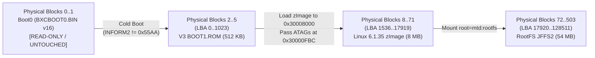

# 01. V3 Linux Installation, Bootloader & Kernel Bring-Up

- **Target**: HP Prime G1 (`G8X92AA` Rev C, S3C2416, Boot0 Recovery `v16`)
- **Related Sources**:
  - [kernel/bootloader/boot.c](../kernel/bootloader/boot.c)
  - [kernel/arch/arm/mach-s3c/mach-hpprime.c](../kernel/arch/arm/mach-s3c/mach-hpprime.c)
  - [scripts/mkimg.sh](../scripts/mkimg.sh)

---

## 1. Non-Destructive Flashing Principles & Boot0 Protection

1. **Boot0 (`mtd1`, Physical NAND Blocks `0~1`, `256 KB`) is Strictly Untouched**:
   - The factory recovery mode (`Reset + Symb` -> USB `03f0:0441` ARMUboot v16) resides inside Boot0.
   - As long as Blocks `0~1` are never modified, the calculator can always enter Recovery Mode even if `BOOT1` or `LINUX.DAT` is corrupted.
   - In our Linux kernel ([mach-hpprime.c](../kernel/arch/arm/mach-s3c/mach-hpprime.c)), both the master `mtd0 "NAND"` and `mtd1 "HP Boot Code"` have `MTD_WRITEABLE` masked out (read-only).
2. **Flash Layout in Recovery Mode (`LBA` Mapping)**:
   - Logical Block Address `LBA 0` in Boot0 Recovery Mode maps to **Physical NAND Block 2** (`offset 0x40000`).
   - **`BOOT1.ROM`**: Flashed to `LBA 0 ~ 1023` (Physical Blocks `2 ~ 5`, `512 KB`).
   - **`LINUX.DAT`** (`zImage` + `rootfs.jffs2`): Flashed to `LBA 1536 ~ 128511` (Physical Blocks `8 ~ 503`, `62.0 MiB`).



---

## 2. Root Causes Solved During Bring-Up

### 2.1 Boot0 USB Vendor Command Protocol (`0x88` / `0x89`) & 32 KB Chunk Size
- **Problem 1**: Legacy LBA 170 `READ_10` unlock triggered a CSW status 7 USB reset in Boot0 v16 because Boot0 compares lock flag `0x30d6f412` before and after `READ_10`.
  - **Fix**: Switched unlock/lock control path exclusively to vendor SCSI commands `0x88` / `0x89` (`0xBEDC 0` unlock, `0xBEDC 100` lock).
- **Problem 2**: 256-sector (`128 KB`) `WRITE_10` transfers failed with `EIO` because the Linux host `usb-storage` driver enforces `max_hw_sectors_kb = 120`.
  - **Fix**: Reduced write chunk size to **64 sectors (`32 KB`)** aligned within 128 KB NAND block boundaries.

### 2.2 Visual Framebuffer Stripe Diagnostics (`0x31F80000`)
Because the HP Prime G1 PCB does not expose UART pins externally, we implemented direct physical framebuffer color stripe markers (`0x31F80000`, `320x240`, `32bpp`) across `BOOT1`, the kernel decompressor (`misc.c`), `head.S`, and `setup_arch()` to pinpoint early boot hangs down to the exact C function.

### 2.3 Critical Kernel Fix: Bare `earlycon` with ATAG Boot (`NULL` FDT Dereference)
- **Symptom**: `BOOT1` loaded `zImage` and verified the magic number (`0x016F2818`), and the kernel decompressor finished, but execution halted inside `setup_arch()` -> `parse_early_param()`.
- **Root Cause**:
  1. `BOOT1` passes `MACH_TYPE_HPPRIMEV2` (`r1 = 1686`) and `ATAG` pointer (`r2 = 0x30000fbc`), with no Device Tree Blob (`initial_boot_params == NULL`).
  2. When `earlycon` (without arguments) was present on the command line, `param_setup_earlycon()` called `early_init_dt_scan_chosen_stdout()`.
  3. In Linux 6.1.35, `early_init_dt_scan_chosen_stdout()` in `drivers/of/fdt.c` passed `initial_boot_params` (`NULL`) directly to `fdt_path_offset(fdt, "/chosen")` before `paging_init` or exception vectors were installed, causing an immediate unrecoverable Data Abort at address `0x00000000`.
- **Fix**:
  1. Added a `NULL` guard in `drivers/of/fdt.c`:
     ```c
     const void *fdt = initial_boot_params;
     if (!fdt)
         return -ENOENT;
     ```
  2. Removed bare `earlycon` from the `BOOT1` kernel command line in [kernel/bootloader/boot.c](../kernel/bootloader/boot.c).

---

## 3. Packaging `LINUX.DAT`

To package `zImage` (up to 8 MB) and `rootfs.jffs2` (up to 54 MB) into a 62 MB `LINUX.DAT` image:
```bash
./scripts/mkimg.sh zImage rootfs.jffs2 LINUX.DAT
```

