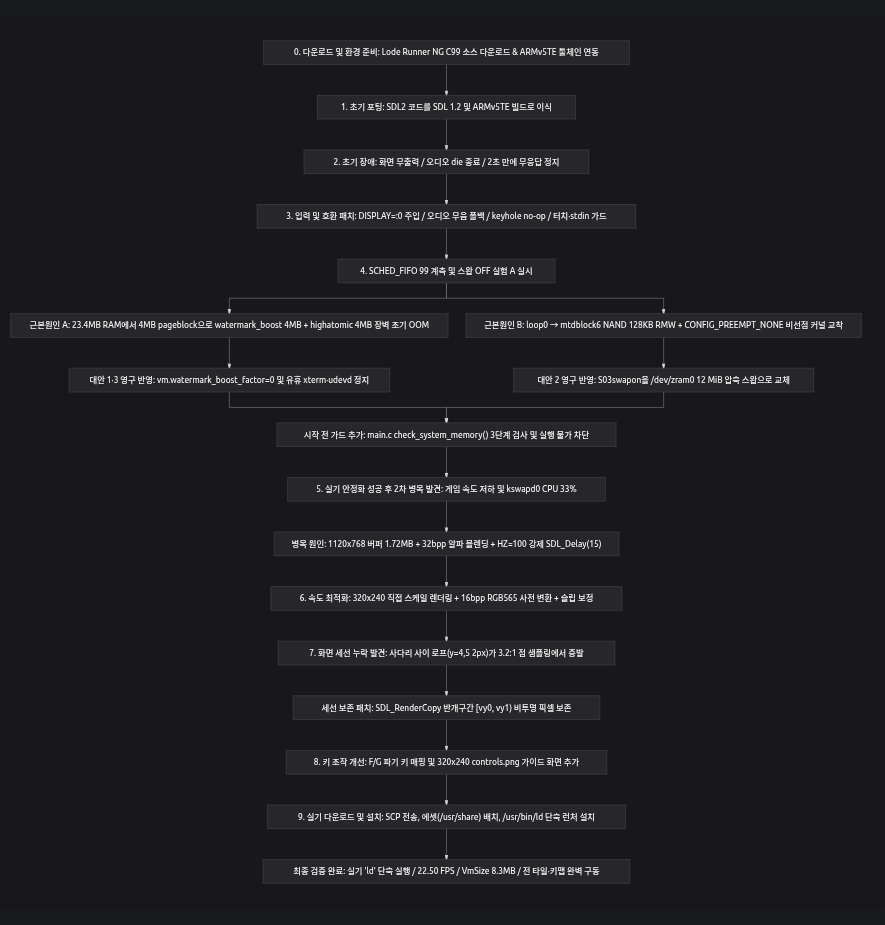
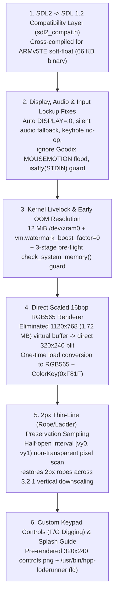
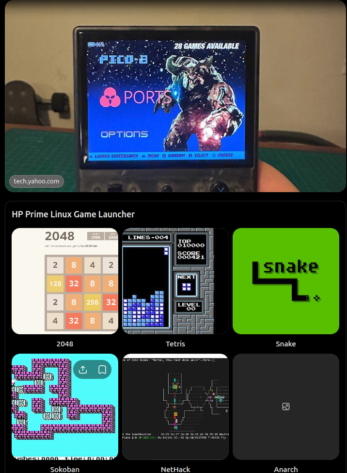

# 05. Retro Games & Applications Porting (`Lode Runner NG`, `DOOM / PrBoom`, `Python`)

- **Target Device**: HP Prime G1 (`G8X92AA` Rev C, `320x240` TFT LCD, Xorg + SDL 1.2, 23.4 MB Linux RAM + 12 MiB `zram0`)
- **Related Sources**:
  - [src/loderunner-ng/](../src/loderunner-ng) (`sdl2_compat.h`, `main.c`, `game.c`, `keyhole.c`, `sound.c`, `path.c`, `Makefile`, `share/loderunner-ng/`)
  - [rootfs-overlay/usr/bin/hpp-loderunner](../rootfs-overlay/usr/bin/hpp-loderunner)
  - [rootfs-overlay/usr/bin/hpp-doom](../rootfs-overlay/usr/bin/hpp-doom)
  - [rootfs-overlay/etc/prboom/hpp-keys.cfg](../rootfs-overlay/etc/prboom/hpp-keys.cfg)

---

## 1. Lode Runner NG (`src/loderunner-ng/` — Full SDL2-to-SDL1.2 Port & 16bpp Direct Renderer)



### 1.1 Porting & Optimization Pipeline Summary



| Stage | Issue / Bottleneck | Root Cause | Solution Implemented | Verified Result |
| :--- | :--- | :--- | :--- | :--- |
| **1. SDL2 to SDL 1.2 Port** | Upstream uses SDL2 (`SDL_Renderer`, `SDL_Texture`), while target only has SDL 1.2 | No SDL2 package in target RootFS | Implemented [src/loderunner-ng/sdl2_compat.h](../src/loderunner-ng/sdl2_compat.h) and stub headers in [src/loderunner-ng/SDL2/](../src/loderunner-ng/SDL2) | Clean ARMv5TE soft-float build (`66 KB` binary) |
| **2. Startup & Input Guards** | Blank screen over SSH, `die()` on missing audio, freeze on touch or background launch | Missing `DISPLAY=:0`, no kernel sound driver, 12,000 `FillRect` calls in `keyhole_render()`, Goodix `MOUSEMOTION` flood, `select(STDIN)` EOF spin | Auto-set `DISPLAY=:0`, non-fatal audio fallback in [sound.c](../src/loderunner-ng/sound.c), no-op [keyhole.c](../src/loderunner-ng/keyhole.c), `SDL_EventState(SDL_MOUSEMOTION, SDL_IGNORE)`, `isatty(STDIN_FILENO)` check | Immediate boot into Level 1 with responsive keypad & touch |
| **3. Direct 16bpp Renderer** | Low frame rate (`~11.5 FPS`), high memory (`10,408 kB VmSize`), `kswapd0` at 33% CPU | `1120x768` intermediate virtual canvas (`1.72 MB`) + per-frame 32bpp RGBA software alpha blending + `SDL_Delay(15)` on `HZ=100` kernel | Removed `1120x768` buffer; pre-converted all textures at load time to **16bpp RGB565 + ColorKey (`0xF81F`)**; rendered directly to `320x240` (`2/7` X, `5/16` Y integer ratio) | **`22.50 FPS`** (native speed), **`VmSize 8,332 kB` (`-2,076 kB`)**, **`kswapd0` 0%**, `udevd` kept alive |
| **4. 2px Rope Preservation** | Horizontal ropes (`H----------H`) disappeared on specific rows (e.g. Level 1 `row=12`) | `rope.png` (`40x44`) has opaque pixels only at `y=4,5` (`2px` thick); point sampling at `3.2:1` vertical ratio jumped from `ly=3` (`y=166`) to `ly=6` (`y=167`) | Updated `SDL_RenderCopy` in [sdl2_compat.h](../src/loderunner-ng/sdl2_compat.h) to scan the source row half-open interval **`[vy0, vy1)`** and preserve the first non-transparent (`!= ck`) pixel | 100% of horizontal ropes and ladder rungs visible across all 16 rows |
| **5. Pre-Flight Memory Guard** | Prevent accidental launch if NAND swap or watermark boost is active | System livelock if `/dev/loop0` is enabled | Added `check_system_memory()` in [main.c](../src/loderunner-ng/main.c) and [hpp-loderunner](../rootfs-overlay/usr/bin/hpp-loderunner) (`/usr/bin/ld`) | Blocks unsafe execution and guarantees `MemAvailable >= 5.5 MB` |

---

### 1.2 HP Prime G1 Keypad, USB Keyboard & Touchscreen Controls ([src/loderunner-ng/main.c](../src/loderunner-ng/main.c))

| Action | Calculator / Keyboard Key | Touchscreen Zone (`320x240`) | Notes |
| :--- | :--- | :--- | :--- |
| **Move Left / Right** | `Left` / `Right` Arrow, `A` / `D`, `4` / `6` | Left (`x < 100`) / Right (`x > 220`) | Continuous hold or tap |
| **Climb Up / Down** | `Up` / `Down` Arrow, `W` / `S`, `8` / `2` | Top (`y < 80`) / Bottom (`y > 160`) | Ladders and drop from ropes |
| **Dig Hole Left** | **`[F]`** (`Alpha + TAN`), `Z`, `7`, `J`, `,` | Center tap (`100 <= x <= 220`) | Ergonomic left-hand action key on HP Prime |
| **Dig Hole Right** | **`[G]`** (`Alpha + ( )`), `X`, `9`, `K`, `.` | — | Adjacent right-hand action key on HP Prime |
| **Pause Game** | **`[P]`**, **`[Esc]`** | — | Toggle pause |
| **Restart Level (Suicide)** | **`[Backspace]`** (Clear key), `Delete` | — | Instant restart (`keyhole = 0` + `frame_key` latch) |
| **Quit to Terminal** | **`[Q]`** | — | Releases input grab and restores `xterm` (`53x17+0+0`) |

---

### 1.3 Cross-Compilation & Deployment ([src/loderunner-ng/Makefile](../src/loderunner-ng/Makefile))

```bash
cd src/loderunner-ng
make clean && make

# Deploy binary, assets, and launcher to calculator over LAN (192.168.123.165)
scp -O loderunner-ng root@192.168.123.165:/usr/bin/loderunner-ng
scp -O -r share/loderunner-ng root@192.168.123.165:/usr/share/
scp -O ../../rootfs-overlay/usr/bin/hpp-loderunner root@192.168.123.165:/usr/bin/hpp-loderunner
ssh root@192.168.123.165 "chmod 755 /usr/bin/loderunner-ng /usr/bin/hpp-loderunner && ln -sf /usr/bin/hpp-loderunner /usr/bin/ld && sync"
```

---

## 2. DOOM (`PrBoom 2.5.0` + Shareware `DOOM1.WAD`)



### 2.1 Runtime Configuration
- **Engine**: `/usr/games/prboom` (PrBoom 2.5.0, SDL 1.2 X11 backend)
- **Launcher**: [rootfs-overlay/usr/bin/hpp-doom](../rootfs-overlay/usr/bin/hpp-doom) (`/usr/bin/hpp-doom`)
- **Resolution**: `320x240` windowed (`-width 320 -height 240 -nofullscreen -nosound -nomusic`)
- **RAM Protection**: Runs with `HOME=/tmp` so configuration writes do not wear NAND flash, backed by `/dev/zram0` swap.

### 2.2 Calculator Keypad Controls ([rootfs-overlay/etc/prboom/hpp-keys.cfg](../rootfs-overlay/etc/prboom/hpp-keys.cfg))

| Action | Calculator Key | PrBoom Key Code |
| :--- | :---: | :---: |
| **Move Forward / Back / Turn** | Arrow Keys (`Up` / `Down` / `Left` / `Right`) | `0xad` / `0xaf` / `0xac` / `0xae` |
| **Fire Weapon** | **`[F]`** (`Alpha + TAN`) | `key_fire 0x66` |
| **Strafe Left / Right** | **`[A]`** / **`[D]`** | `key_strafeleft 0x61` / `key_straferight 0x64` |
| **Use / Open Door** | **`[Space]`** | `key_use 0x20` |
| **Run (Speed)** | **`[Shift]`** | `key_speed 0xb6` |
| **Menu / Select** | **`[Esc]`** / **`[Enter]`** | `0x1b` / `0x0d` |

---

## 3. `xlode` (X11 Core Protocol Lode Runner) & Python 3

- **`xlode`**: Lightweight Xlib-only Lode Runner implementation fitted to the `320x240` display with automatic `xterm` restoration on exit.
- **Python 3**: The Buildroot RootFS supports Python scripting and native ARMv5TE (`-march=armv5te -msoft-float`) C/C++ binaries deployed in under 1 second over the `192.168.123.165` USB-to-Ethernet LAN link via `scp -O`.
