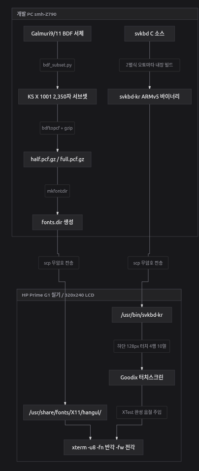
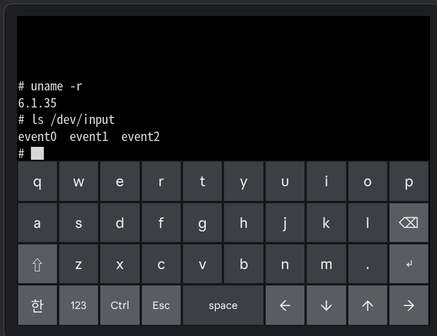

# 07. Korean PCF Bitmap Font & Ultra-Lightweight 2-Bulsik Touchscreen Virtual Keyboard (`hpp-vkbd`)

- **Target Device**: HP Prime G1 (`G8X92AA` Rev C, `320x240` TFT LCD, Goodix Touchscreen, 32 MB RAM)
- **Related Sources**:
  - [src/korean-fonts/bdf_subset.py](../src/korean-fonts/bdf_subset.py)
  - [src/hpp-vkbd/hpp_vkbd.c](../src/hpp-vkbd/hpp_vkbd.c)
  - [src/hpp-vkbd/hangul_automata.c](../src/hpp-vkbd/hangul_automata.c)
  - [src/hpp-vkbd/hangul_automata.h](../src/hpp-vkbd/hangul_automata.h)
  - [src/hpp-vkbd/keymap_layout.h](../src/hpp-vkbd/keymap_layout.h)
  - [src/hpp-vkbd/hpp-vkbd-toggle](../src/hpp-vkbd/hpp-vkbd-toggle)
  - [rootfs-overlay/etc/X11/xorg.conf.d/10-hangul-fonts.conf](../rootfs-overlay/etc/X11/xorg.conf.d/10-hangul-fonts.conf)
  - [rootfs-overlay/usr/share/fonts/X11/hangul/](../rootfs-overlay/usr/share/fonts/X11/hangul)

---

## 1. Design Constraints & Architecture

1. **Zero Xft / Fontconfig Memory Overhead**:
   - Loading TrueType outlines via `libXft`/`freetype` spikes anonymous RAM consumption on a 23.4 MB system.
   - Instead, both `xterm` and `hpp-vkbd` share **X11 Core Bitmap Fonts (`PCF.gz`)** loaded directly by the Xorg server (`XLoadQueryFont`).
2. **Strict 1:2 Half-Width / Full-Width Charcell Alignment**:
   - Using [src/korean-fonts/bdf_subset.py](../src/korean-fonts/bdf_subset.py), we extracted exact `DWIDTH` charcell (`SPACING "C"`) subsets from **GalmuriMono11** (`6x16` half-width `half.pcf.gz` `3.4 KB` / `12x16` full-width `full.pcf.gz` `46 KB`) and **GalmuriMono9** (`5x12` / `10x12`), totaling **`108 KB`** on JFFS2 (well under the `200 KB` budget).
   - Includes ASCII (`0020-007E`), Latin-1 (`00A0-00FF`), Arrows (`2190-21FF`), Box Drawing (`2500-257F`), **KS X 1001 2,350 Hangul syllables**, and **Hangul Compatibility Jamo (`3131-318E`)**.




---

## 2. Xorg FontPath Registration & UTF-8 XTerm Configuration

- **[rootfs-overlay/etc/X11/xorg.conf.d/10-hangul-fonts.conf](../rootfs-overlay/etc/X11/xorg.conf.d/10-hangul-fonts.conf)**:
  ```text
  Section "Files"
      FontPath "/usr/share/fonts/X11/hangul/"
      FontPath "/usr/share/fonts/X11/misc/"
      FontPath "built-ins"
  EndSection
  ```
  *(Note: Explicit inclusion of `misc/` and `built-ins` is mandatory because Xorg overrides its compiled-in default `FontPath` whenever `Section "Files"` defines any `FontPath`.)*
- **[rootfs-overlay/etc/init.d/S99xterm](../rootfs-overlay/etc/init.d/S99xterm)**:
  ```sh
  cd /root && HOME=/root DISPLAY=:0 xterm -u8 -wc -cjk_width -fn kr-half -fw kr-full -ls -geometry 52x14+0+0 &
  ```

---

## 3. Ultra-Lightweight 2-Bulsik Virtual Keyboard (`hpp-vkbd`)

### 3.1 Key Technical Features
1. **Pure `libX11` + `libXtst` Binary (`66 KB` stripped)**:
   - Dynamically discovers two unused keycodes (ping-pong slots `248` and `230`) via `XGetKeyboardMapping`, maps `0x01000000 | Unicode` keysyms on the fly with `XChangeKeyboardMapping`, and injects keystrokes via `XTestFakeKeyEvent`.
2. **WM-Less Focus Preservation & Dynamic XTerm Resizing (`320x240` <-> `320x96`)**:
   - Uses `override_redirect = True` so touchscreen taps on the virtual keyboard never steal X11 input focus from `xterm`.
   - Automatically finds the `XTerm` window via `XQueryTree`/`XGetClassHint` and calls `XMoveResizeWindow` to shrink `xterm` to the top **`320x96`** (`y: 0..95`) when shown, restoring `xterm` to full-screen **`320x240`** when hidden (`SIGTERM` or `[HIDE X]` touch button).
3. **2-Bulsik Hangul Automata & `16px` Pre-Commit Composition Bar (`y: 96..111`)**:
   - Full 2-Bulsik state machine ([src/hpp-vkbd/hangul_automata.c](../src/hpp-vkbd/hangul_automata.c)): 19 initial consonants, 21 medial vowels (including 7 compound vowels `ㅘ ㅙ ㅚ ㅝ ㅞ ㅟ ㅢ`), 27 final consonants (including 11 compound finals `ㄳ ㄵ ㄶ ㄺ ㄻ ㄼ ㄽ ㄾ ㄿ ㅀ ㅄ`), and Dokkaebibul liaison splitting.
   - Composing syllables are buffered inside the **`16px` composition bar (`Comp:[한]`)** so pressing `BS` during composition decomposes Jamo step-by-step without sending multibyte backspaces to BusyBox `ash`, completely avoiding UTF-8 byte corruption.
4. **6 Keyboard Layers (`4 rows x 10 cols`, `32x32 px` keys at `y: 112..239`)**:
   - `LAYER_EN_LOWER` / `LAYER_EN_UPPER` (oneshot `SHF`)
   - `LAYER_KR_BASE` (2-Bulsik `ㅂㅈㄷㄱㅅ...`) / `LAYER_KR_SHIFT` (`ㅃㅉㄸㄲㅆㅒㅖ`)
   - `LAYER_SYM_1` (`1..0 - _ = / \ | ~ ' " ( ) < > & * ; :`) / `LAYER_SYM_2` (`! @ # $ % ^ + \` ? . [ ] { } ,`)
   - Oneshot sticky `CTL` (`Control_L`), `ESC`, `TAB`, `SPACE` (2-column `64x32 px`), and Arrow keys (`← ↓ ↑ →`).
5. **Physical `[Menu]` Key Toggle**:
   - Pressing the calculator's physical **`[Menu]`** key triggers `MENU = /usr/bin/hpp-vkbd-toggle` via `input-event-daemon`, instantaneously showing or hiding the virtual keyboard.

---

## 4. Live Hardware Resource Measurements

| Metric | Target Budget | Measured on Device (`192.168.123.165`) | Result |
| :--- | :---: | :---: | :---: |
| **Korean PCF Font Directory (`/usr/share/fonts/X11/hangul/`)** | `<= 200 KB` | **`108 KB`** (`half` + `full` for Mono 11 & Mono 9) | **PASS** |
| **`hpp-vkbd` Binary Size (ARMv5TE stripped)** | `<= 100 KB` | **`66 KB`** | **PASS** |
| **`hpp-vkbd` Anonymous RAM (`RssAnon`)** | `<= 800 KB` | **`744 kB`** (`VmRSS 1,816 kB` shared Xlib) | **PASS** |
| **System `MemAvailable` (Xorg + Korean XTerm + `hpp-vkbd`)** | `>= 3,000 kB` | **`3,380 kB`** (`JFFS2` free: `11.0 MB`) | **PASS** |

