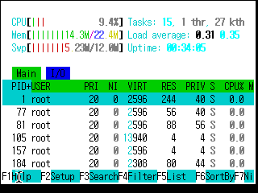
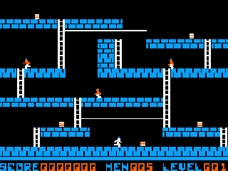
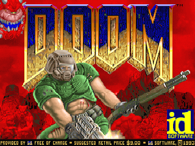
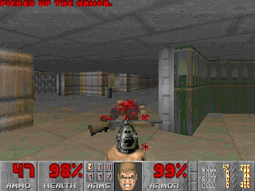

# System Resource Monitor (`htop`) & Direct-Framebuffer LCD Capture (`lcd-capture`)

- **Target Hardware**: HP Prime G1 (`G8X92AA` Rev C, Samsung S3C2416 @ 400 MHz, 32 MB RAM, 320×240 LCD)
- **Sources**: [src/htop/](../src/htop/README.md) · [src/lcd-capture/](../src/lcd-capture/README.md)

---

## 1. Live `320x240` Hardware Captures (Captured on Real Calculator)

All screenshots below were captured directly from the HP Prime G1 physical scanout framebuffer (`0x31F80000`) using `lcd-capture`:

| `htop` Live Resource Monitor | Lode Runner NG (`LEVEL 001`) | DOOM Title Screen (`PrBoom`) | DOOM In-Game (`320x240`) |
| :---: | :---: | :---: | :---: |
|  |  |  |  |

---

## 2. `htop` for ARMv5TEJ Non-Wide `ncurses` ([src/htop/](../src/htop/README.md))

- Built out-of-tree via [../src/htop/build.sh](../src/htop/build.sh) using `--host=arm-buildroot-linux-gnueabi`, `CFLAGS="-Os -pipe"`, and **`--disable-unicode --with-curses=ncurses`** because Buildroot 2023.02.6 on target ships only non-wide `libncurses.so.6.4`.
- **Footprint & Runtime Check**:
  - Binary: `269,204` B (~263 KB stripped PIE ARMv5TEJ).
  - `ldd` deps: `libncurses.so.6`, `libm.so.6`, `libc.so.6`, `/lib/ld-linux.so.3` (100% present on stock JFFS2).
  - `htop --version`: **`htop 3.6.0-dev`**.
  - Verified live telemetry on `320x240` XTerm (`assets/lcd-htop.png`): `CPU 9.4%`, `Mem 14.3M/22.4M`, `Swp 5.23M/12.0M`, `Tasks: 15`, exit cleanly via `q`, `F10`, or `[Help]+[C]`.

---

## 3. Direct Scanout `lcd-capture` Tool ([src/lcd-capture/](../src/lcd-capture/README.md))

- **Why `/dev/fb0` fails under Xorg**: On Linux 6.1.35 `simpledrm` (`modeset(0)`), `/dev/fb0` holds a stale boot-time `fbcon` buffer, while live Xorg and SDL 1.2 apps write to `simple-framebuffer` at physical address **`0x31F80000`** (`320x240x32bpp`, stride `1280` B; see [kernel/arch/arm/mach-s3c/mach-hpprime.c](../kernel/arch/arm/mach-s3c/mach-hpprime.c)).
- **Implementation ([../src/lcd-capture/src/lcd_capture.c](../src/lcd-capture/src/lcd_capture.c))**:
  - `hw` backend reads `/proc/iomem` (`simple-framebuffer`), maps `/dev/mem` read-only (`O_RDONLY`), and encodes lossless **PNG** (`libpng16`), **BMP**, or **PPM** without touching calculator flash when streamed to stdout (`-o -`).
  - Also supports `--source x11` (`XGetImage`), `--source fb` (`/dev/fb0`), and `--source test` (color-bar self-test producing an identical `801`-byte PNG).
- **Zero-Write PC Streaming ([../src/lcd-capture/capture_from_pc.sh](../src/lcd-capture/capture_from_pc.sh))**:
  ```bash
  ./src/lcd-capture/capture_from_pc.sh -d 3 shot.png
  ```
- Additional DOOM menu capture stored at [assets/lcd-doom-menu.png](assets/lcd-doom-menu.png) (`37,999` B).

